<div align="center">

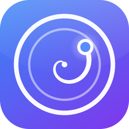

# DriftLab

**Fix stick drift. For real.**

Diagnose, measure and (where software can) repair gamepad stick drift – for DualShock 4, DualSense and Xbox controllers.
And tell you honestly when it can't be fixed in software.

[](https://github.com/LaFAirs/driftlab/actions/workflows/ci.yml)
[](https://github.com/LaFAirs/driftlab/releases/latest)
[](https://github.com/LaFAirs/driftlab/releases)
[](LICENSE)


[**⬇ Windows**](https://github.com/LaFAirs/driftlab/releases/latest) · [**⬇ Linux**](https://github.com/LaFAirs/driftlab/releases/latest) · [**⬇ macOS**](https://github.com/LaFAirs/driftlab/releases/latest)

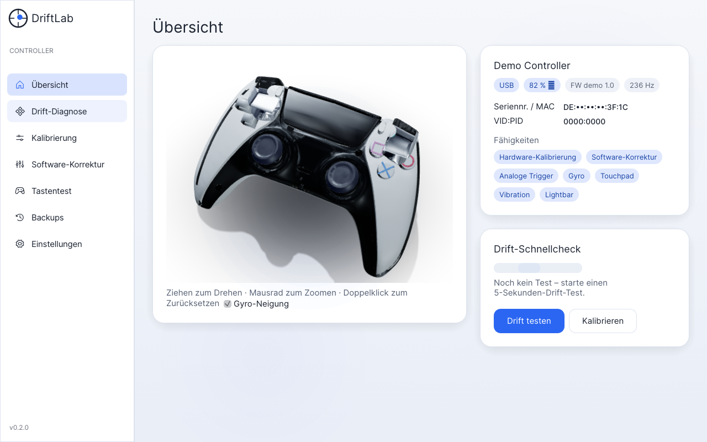

</div>

## Why DriftLab?

Stick drift has two causes: a **bad calibration** (fixable) or **worn potentiometers** (only a part swap fixes that). DriftLab fixes everything that *can* be fixed in software, proves the result with a before/after measurement, and never claims success the numbers don't show.

* **Measure, don't guess** – a 5-second test with outlier filtering gives centre offset, noise, jitter and a 0–100 drift score.
* **Real hardware calibration** for DualShock 4, DualSense and DualSense Edge over USB – always with a backup first, applied *temporarily* first, saved permanently only if you say so.
* **Software correction for every controller**, including Xbox: centre offset, four deadzone types, curves, circularity, auto-optimise, per-controller profiles.
* **Honest diagnosis** – if the hardware is worn the app says so and lists your options (warranty, stick module swap, Hall-effect modules, repair).
* A native, fast app (Rust + wgpu). No Electron, no webview, no telemetry.

## Features

| | |
|---|---|
| 🎮 Live 3D controller, sticks/triggers/buttons animate with your input | 🔌 Hotplug for USB **and** Bluetooth, no restart |
| 🎨 Theme follows the controller (PS5 white/blue, PS4 black/blue, Xbox black/green) with smooth OKLab blending | 📈 Drift test, circularity test, trigger test, CSV/JSON export, PNG report |
| 🛡 Safety gates: USB only, battery ≥ 30 %, firmware check, backup, temp-first | 🧰 Backups screen, restore, expert-mode HID inspector |
| 🌍 English + Deutsch, UI scale 80–200 %, reduced motion, keyboard focus | 🖥 `driftlab-cli` for scripting (`list`, `monitor`, `drift-test`, `dump-calibration`) |

## Gallery

<table>
<tr>
<td>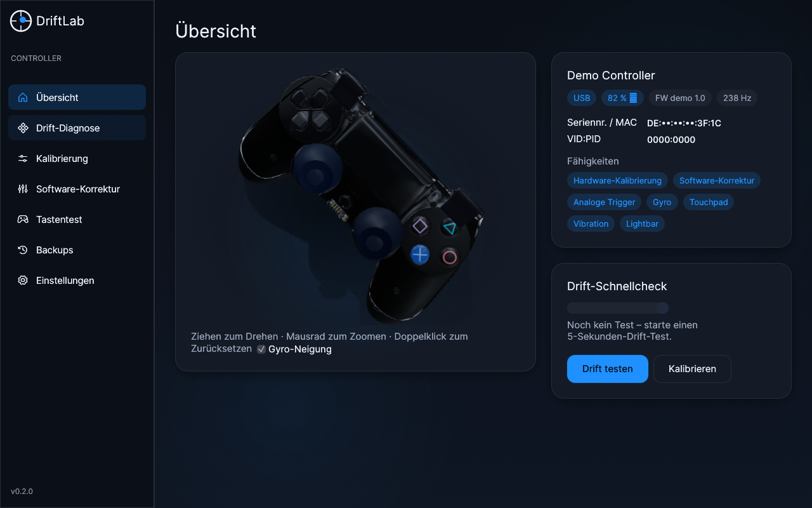<br><sub>PS4 – black &amp; blue</sub></td>
<td>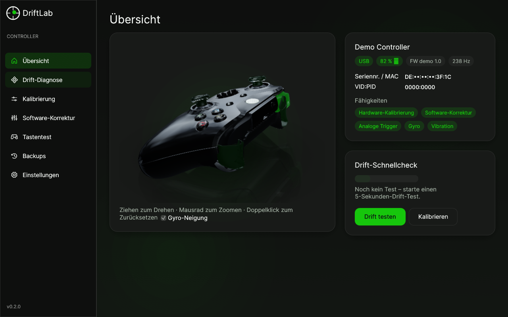<br><sub>Xbox – black &amp; green</sub></td>
</tr>
<tr>
<td>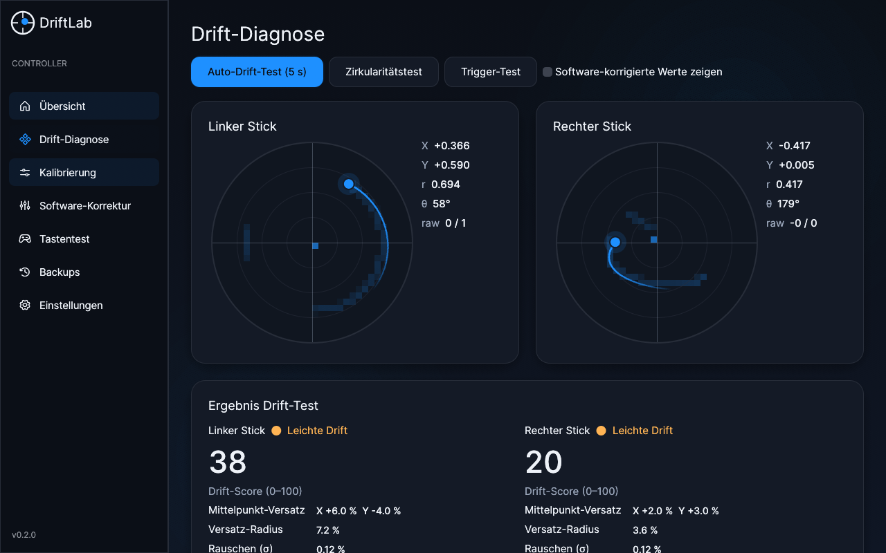<br><sub>Drift diagnosis</sub></td>
<td>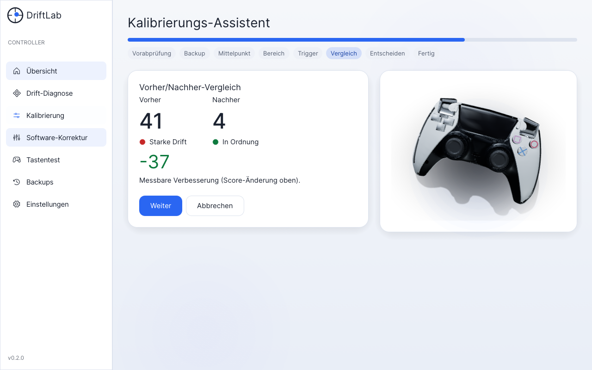<br><sub>Calibration wizard – before/after</sub></td>
</tr>
<tr>
<td colspan="2">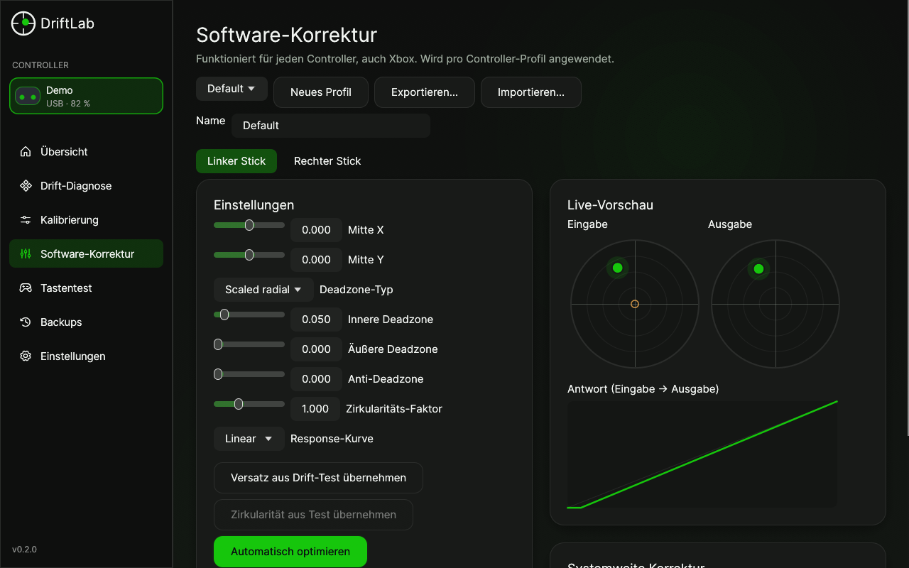<br><sub>Software correction with live preview</sub></td>
</tr>
</table>

## The 3D models

<table>
<tr>
<td>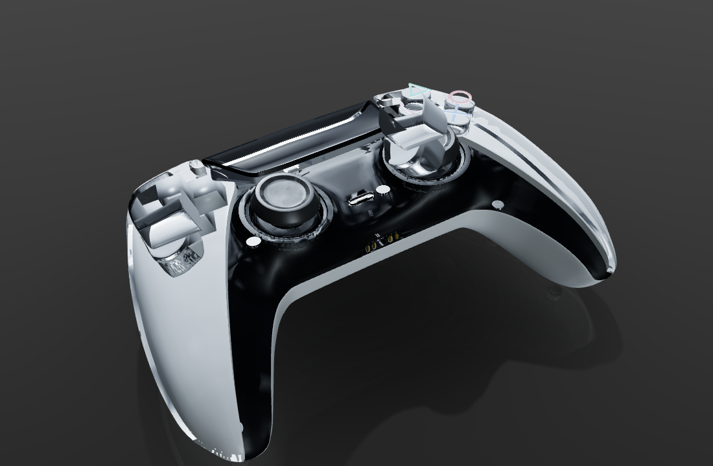<br><sub>DualSense</sub></td>
<td>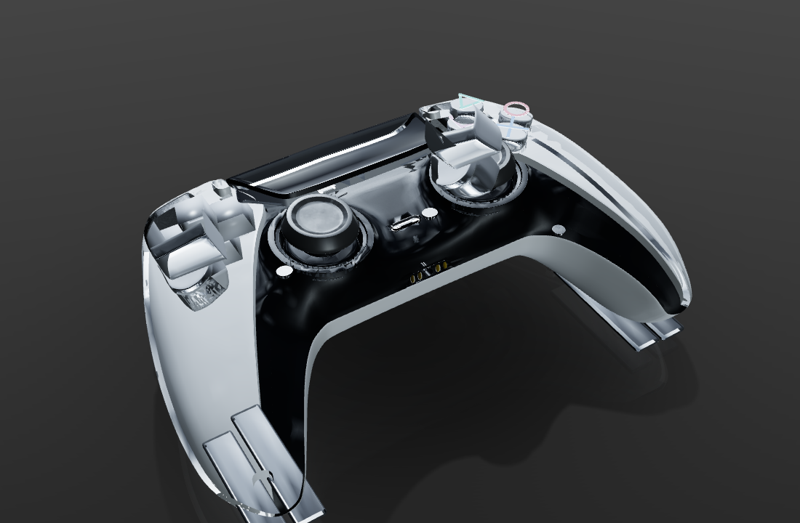<br><sub>DualSense Edge (approximation)</sub></td>
<td>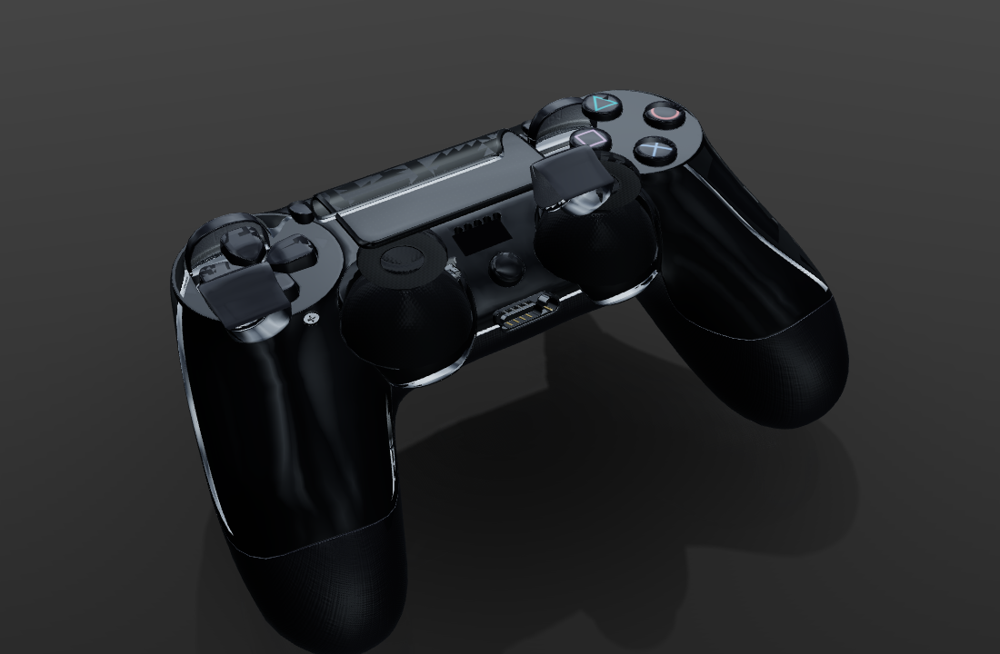<br><sub>DualShock 4</sub></td>
</tr>
<tr>
<td>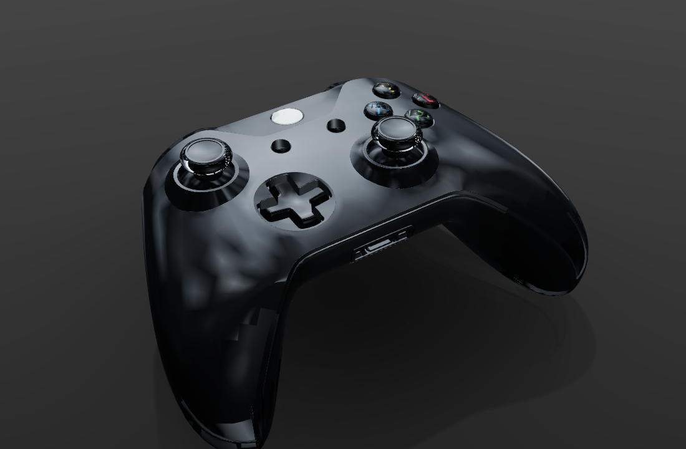<br><sub>Xbox One / Series</sub></td>
<td>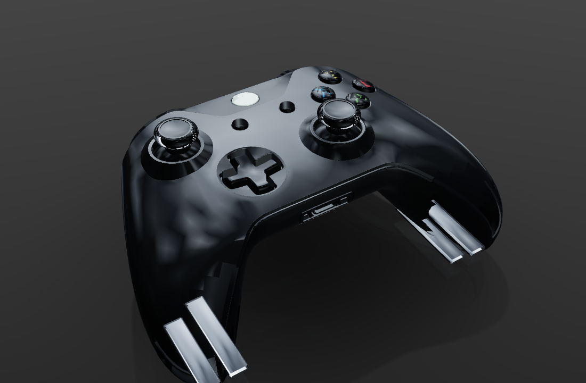<br><sub>Xbox Elite (approximation)</sub></td>
<td></td>
</tr>
</table>

*DriftLab is not affiliated with Sony, Microsoft or any controller manufacturer. Product names are trademarks of their owners; no logos are shown.*

## Known limitations

- Hardware calibration (DualShock 4, DualSense / Edge) follows the public protocol and is covered by tests, but **has not been verified on physical hardware** – see [`docs/HARDWARE_TESTING.md`](docs/HARDWARE_TESTING.md).
- No system-wide virtual controller (no maintained driver on Windows/macOS); use the Steam Input export.
- Edge and Elite 3D models are approximations (standard model + own paddles). DualSense bumpers are part of the shell mesh and not animated separately; the DualSense touchpad is shown black.
- Rumble for Xbox / generic pads is not implemented; Xbox controllers have no open calibration protocol.
- Release binaries are not code-signed (SmartScreen / Gatekeeper warnings).
- Not tested on 200 % Windows scaling and on Linux/macOS hardware beyond CI builds.

## Supported controllers

✅ works · ⚠️ limited (see notes) · ❌ not available

| Controller | Detection | 3D model | Hardware calibration | Software correction | Gyro | Vibration |
|---|:-:|:-:|:-:|:-:|:-:|:-:|
| DualSense (PS5) | ✅ | ✅ | ⚠️ ¹ | ✅ | ✅ | ✅ (USB) |
| DualSense Edge | ✅ | ✅ | ⚠️ ¹ | ✅ | ✅ | ✅ (USB) |
| DualShock 4 v1 / v2 | ✅ | ✅ | ⚠️ ¹ ² | ✅ | ✅ | ✅ (USB) |
| Xbox One / Series / Elite 2 | ✅ | ✅ | ❌ ³ | ✅ | ❌ | ❌ ⁴ |
| Other gamepads | ✅ | ⚠️ generic | ❌ | ✅ | ❌ | ❌ |

¹ Implemented from the public protocol and covered by tests, **not yet verified on physical hardware** – help us test with [`docs/HARDWARE_TESTING.md`](docs/HARDWARE_TESTING.md).
² DS4 stick calibration cannot be read back, so it cannot be restored from a backup.
³ Xbox controllers have no open calibration protocol.
⁴ Rumble for Xbox/generic pads is not implemented.

**3D models:** real, licensed `.glb` models (CC BY 4.0, see [`CREDITS.md`](CREDITS.md)) – DualSense (be the knight), DualShock 4 (shaielwolf), Xbox One/Series (TdoubleU8). The **DualSense Edge** and **Xbox Elite** views are *approximations*: the standard model plus four own rear paddles, not scans of those products. The DualSense touchpad is shown black by design. Manufacturer logos and lettering are removed from all models.

## Download

Get the installer for your system from the [latest release](https://github.com/LaFAirs/driftlab/releases/latest):

| Platform | Files |
|---|---|
| Windows 10/11 x64 | `DriftLab-x.y.z-windows-x64-setup.exe` (installer) · `…-portable.zip` |
| Linux x64 | `DriftLab-x.y.z-linux-x86_64.AppImage` · `DriftLab-x.y.z-linux-amd64.deb` (installs the udev rule) |
| macOS (Apple Silicon + Intel) | `DriftLab-x.y.z-macos-universal.dmg` |

Verify downloads with `SHA256SUMS.txt` (and `gh attestation verify <file> --repo LaFAirs/driftlab`).

**Linux, AppImage:** copy `70-driftlab.rules` (inside the repo under `packaging/linux/`) to `/etc/udev/rules.d/` once so controllers are accessible without root, then `sudo udevadm control --reload-rules`.

## How it works

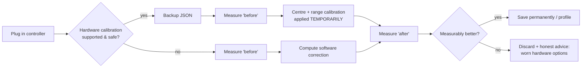

The maths (median/MAD filtering, drift score, deadzones, curves) is documented in [`docs/CALIBRATION_MATH.md`](docs/CALIBRATION_MATH.md); protocols in [`docs/PROTOCOLS.md`](docs/PROTOCOLS.md).

## FAQ

**Can DriftLab fix every drift?** No. Calibration fixes a wrong centre/range. If the potentiometer is worn (noisy, jumpy, far off-centre) software can only mask it with a larger deadzone. DriftLab measures noise and jitter and tells you "probably worn hardware" when that is the case.

**Is it safe?** Hardware calibration writes to the controller. DriftLab only allows it over USB, with battery ≥ 30 % and a readable firmware version, makes a JSON backup first, applies temporarily first (gone after a controller restart), aborts to a safe state on any error or unplug, and only saves permanently after your explicit choice. Still: use at your own risk, and see the limitation about hardware verification above.

**Why does Windows warn me during install?** The release binaries are not code-signed (a certificate costs money). SmartScreen shows "unknown publisher": choose *More info → Run anyway* after verifying the checksum. On macOS, right-click → *Open* the first time.

**Does it void my warranty?** DriftLab uses the same feature reports as community tools and no firmware modification, but we can't speak for manufacturers. If your controller is still under warranty, **try the manufacturer's repair first** – that is the safest option.

**Why no system-wide correction for Xbox in games?** A virtual controller needs a maintained driver. On Windows the common one (ViGEmBus) is retired; on Linux a `uinput` implementation is on the roadmap; macOS has no option. For now export the values for **Steam Input** (button in *Software correction*).

**Does it phone home?** No. The only network call is the optional *Check for updates* button.

## Build from source

```bash
rustup default stable
git clone https://github.com/LaFAirs/driftlab && cd driftlab
cargo run --release -p driftlab-app            # GUI
cargo run --release -p driftlab-app -- --demo  # GUI with the simulated controller
cargo run -p driftlab-cli -- list              # CLI
cargo xtask screenshots                         # regenerate the README screenshots
```

Linux build dependencies: `libudev-dev libusb-1.0-0-dev libxkbcommon-dev libwayland-dev libx11-dev libxcursor-dev libxi-dev libxrandr-dev libgtk-3-dev`.

## Project structure

```
crates/driftlab-core    devices, HID protocols, calibration maths, profiles, safety (no UI)
crates/driftlab-render  glTF model loader + PBR/IBL wgpu renderer (procedural fallback for generic pads)
crates/driftlab-app     egui GUI, themes, i18n, screens
crates/driftlab-cli     diagnostics CLI
xtask/                  icons, banners, screenshots
assets/                 controller database, fonts, icons
packaging/              Inno Setup, udev rules, .desktop, macOS plist
docs/                   architecture, maths, protocols, decisions, hardware testing
```

## Roadmap

- [ ] Verify and polish hardware calibration on real devices (help wanted!)
- [ ] `uinput` virtual controller on Linux for system-wide correction
- [ ] Rumble for Xbox/generic pads
- [ ] DualSense trigger/adaptive-trigger tests
- [ ] More controllers (Switch Pro, 8BitDo, …)
- [ ] Code-signed installers

## Contributing

See [CONTRIBUTING.md](CONTRIBUTING.md) and the [Code of Conduct](CODE_OF_CONDUCT.md). New controller? [`docs/ADDING_A_CONTROLLER.md`](docs/ADDING_A_CONTROLLER.md).

## Credits

* [dualshock-tools](https://github.com/dualshock-tools/dualshock-tools.github.io) (MIT) – calibration protocol reference
* Linux `hid-sony.c` / `hid-playstation.c`, SDL `SDL_hidapi_ps4.c` / `SDL_hidapi_ps5.c` – report layout documentation
* [egui](https://github.com/emilk/egui), [wgpu](https://wgpu.rs), [hidapi](https://crates.io/crates/hidapi), [gilrs](https://crates.io/crates/gilrs)
* [Inter](https://rsms.me/inter/) typeface (SIL OFL 1.1) · [Phosphor Icons](https://phosphoricons.com) (MIT)

## Disclaimer & trademarks

DriftLab is provided "as is", without warranty; hardware calibration is performed at your own risk.

**DriftLab is not affiliated with, endorsed or sponsored by Sony Interactive Entertainment or Microsoft. All trademarks belong to their respective owners.**
The 3D models are original stylised designs; no official assets, logos or symbols are used.

## License

[MIT](LICENSE) © DriftLab contributors
