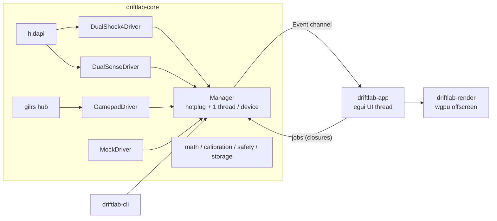

# Architecture

## Crates

| Crate | Responsibility |
|---|---|
| `driftlab-core` | Device database (`assets/controllers.toml`), hotplug manager, `ControllerDriver` trait and implementations, report parsers, calibration maths, safety pre-flight, backups/profiles/settings. No UI dependencies. |
| `driftlab-render` | Procedural, original controller models (named parts), WGSL shader (key/fill light, rim, baked-style AO), 4× MSAA offscreen target resolved into a texture. |
| `driftlab-app` | egui/eframe app: theme tokens + OKLab transitions, i18n (EN/DE), screens, 3D view widget with 2D fallback, screenshot mode. |
| `driftlab-cli` | `list`, `monitor`, `drift-test`, `dump-calibration` (all support `--demo`). |
| `xtask` | Icon / banner / screenshot generation. |

## Threading

* One **hotplug thread** polls the HID device list every 500 ms and owns the gilrs hub thread.
* One **input thread per device** polls the driver (≥ 250 Hz when the device delivers it, capped by *Settings → Max. polling rate*) and sends `Event::Input` over a lock-free channel.
* The **UI thread never touches a device**. Feature-report work (backup, hardware calibration, commit, restore) is sent as closures to the device thread (`DeviceHandle::exec`); the result comes back through a channel and is polled each frame.
* Disconnects surface as `Event::Removed`; a running wizard is reset and the hardware session aborted.

## 3D rendering

The renderer draws into its own colour/depth/MSAA targets and resolves into a texture which egui shows as an image (registered with `register_native_texture`). This keeps it independent from egui's render-pass configuration. If wgpu is unavailable (or `--2d` / `DRIFTLAB_2D` is set) the app draws a vector controller with the same live animations.

## Models

Models are built procedurally in Rust (`driftlab-render/src/model.rs`) from superellipsoids, cylinders and rounded boxes. They are original, stylised designs with named parts (`stick_l`, `trigger_r`, `dpad_up`, `face_bottom`, `touchpad`, `lightbar`, …). No official assets, logos or brand symbols are used. See `docs/DECISIONS.md` for why this replaces Blender/glTF assets.
